# Bin-Push Grasp Pipeline — Review Companion

Simplified companion to `STAGE_REWARD_FLOW.md` (which is the exact, code-derived
source of truth for stage/reward/gate values). This doc trades precision for
scannability, and calls out where known issues sit in the flow, for a joint
review pass.

```mermaid
flowchart TD
    RESET(["Episode / staged reset<br/>(sampled 40% APPROACH / 40% REACH / 20% GRASP / 0% PUSH)"]) --> APPROACH

    subgraph APPROACH["STAGE 0 — APPROACH (≤200 steps)"]
        direction TB
        A_DO["Policy walks the robot toward the bin.<br/>Fingers not controlled by the policy yet."]
        A_RW["Rewards: close the distance, then stop<br/>and settle at a grasp-ready stance."]
        A_GATE["Gate to REACH:<br/>stance close enough (position + heading)<br/>AND robot has actually stopped moving"]
        A_DO --> A_RW --> A_GATE
    end

    APPROACH -->|gate passes| REACH
    APPROACH -.->|200-step timeout| FAIL

    subgraph REACH["STAGE 1 — REACH (≤100 steps)"]
        direction TB
        R_DO["Both hands forced OPEN.<br/>Policy swings each palm up-and-over<br/>the rim toward its handle."]
        R_RW["Rewards: per-hand reach distance,<br/>staying open, holding the approach<br/>stance, palm facing down at the handle."]
        R_GATE["Gate to GRASP (held 5 steps):<br/>both palms close to their handles,<br/>fingers still open, robot stance settled,<br/>palms oriented correctly"]
        R_DO --> R_RW --> R_GATE
    end

    REACH -->|gate passes| GRASP
    REACH -.->|100-step timeout| FAIL

    subgraph GRASP["STAGE 2 — GRASP (≤80 steps)"]
        direction TB
        G_DO["Per hand, independently: stay OPEN until<br/>close + touching + correctly oriented,<br/>then latch CLOSED and stay closed."]
        G_RW["Rewards: finger closing progress, distance<br/>to the fine grasp point, contact, staying<br/>in the reach stance, palm orientation."]
        G_GATE["Gate to PUSH (held 8 steps):<br/>≥1 contact link per hand, both palms<br/>very close, both hands closed,<br/>⚠️ orientation check here is INCOMPLETE<br/>(see Known Issues #1)"]
        G_DO --> G_RW --> G_GATE
    end

    GRASP -->|gate passes| PUSH
    GRASP -.->|80-step timeout| FAIL

    subgraph PUSH["STAGE 3 — PUSH (≤300 steps)"]
        direction TB
        P_DO["Both fingers forced CLOSED.<br/>Policy walks forward, steering the bin."]
        P_RW["Rewards: forward progress on the bin,<br/>forward stepping, maintaining the grasp,<br/>finger/contact/orientation upkeep."]
        P_PEN["Penalties: bin tilting wrong, wheel kicks,<br/>the two hands gripping unevenly."]
        P_GATE["Complete:<br/>grasp still valid AND bin moved > 1 m"]
        P_DO --> P_RW --> P_PEN --> P_GATE
    end

    PUSH -->|complete| SUCCESS(["Task complete (+reward)<br/>reset after a short delay"])
    PUSH -.->|300-step timeout, OR grasp lost<br/>past a short grace window| FAIL(["Episode reset<br/>(fail)"])

    ALWAYS["Always active, every stage:<br/>+1 per-step for occupying any stage (bigger in PUSH)<br/>−1000 on hard termination (e.g. falling)<br/>DOF/action-smoothness/contact/upright penalties<br/>−penalty for not facing the bin (APPROACH/REACH/GRASP)"]
    ALWAYS -.-> APPROACH
    ALWAYS -.-> REACH
    ALWAYS -.-> GRASP
    ALWAYS -.-> PUSH
```

## Known issues (for review)

1. **GRASP-stage "is this a valid grasp?" gate doesn't check hand twist.**
   The gate that lets an episode advance out of GRASP (and that later re-checks
   "is the grasp still good" during PUSH) checks contact, proximity, and finger
   closure — but not whether the hand is *twisted* about the palm-down axis.
   A sibling check earlier in the pipeline (REACH→GRASP entry) does check twist.
   Net effect: a hand can be touching, close, and closed, but rotated wrong, and
   still count as a valid grasp — consistent with the reward config's own
   history of twist never fully converging despite several dedicated reward
   terms aimed at it.

2. **Episode reset doesn't restore the intended standing pose.**
   On reset, only the wrist/finger joints get their real target; every other
   joint (legs, torso) resets to a flat zero position instead of the
   configured standing pose — every single episode may be starting from an
   unnaturally flat, potentially unstable stance.

3. **Bin domain randomization (mass/friction/wheel drive) is currently
   disabled — intentionally.** Not a bug to fix; left off on purpose until
   grasping is reliable enough to be worth randomizing against.

4. **Open question, under investigation:** does the OPEN finger target during
   REACH sit at full/straight extension rather than a pre-curled shape? If so,
   the final close motion may not naturally sweep around the handle. Not yet
   confirmed against the actual finger-target code as of this doc's writing.

## Not shown here

Exact reward scale values, standoff/tolerance distances, and the full dated
tuning history (which reward changed, when, and why) all live in
`reward_bin_push_homie.yaml` and `config/env/bin_push_homie.yaml` — read those
directly for ground truth on numbers; this doc is deliberately structural.
