# Move-Garbage Stage and Reward Flow

This diagram reflects the current implementation in
`move_garbage/envs/bin_push_homie.py` and the active values in
`move_garbage/config/env/bin_push_homie.yaml` and
`move_garbage/config/rewards/wbmanip/reward_bin_push_homie.yaml`.

```mermaid
flowchart TD
    RESET([Episode or staged reset]) --> A

    subgraph A["Stage 0: APPROACH - max 200 control steps"]
        A1["Policy controls locomotion and upper body<br/>Finger commands are not overridden"]
        A2["Rewards<br/>+ walk_to_bin 5<br/>+ stop_at_bin 8<br/>+ reach_finger_open 1.5<br/>- upper-body deviation 1"]
        A3["Advance gate<br/>standoff error < 8 cm<br/>lateral error < 12 cm<br/>root speed < 0.2 m/s<br/>upper-body max deviation < 0.3 rad"]
        A1 --> A2 --> A3
    end

    A3 -->|gate true| B

    subgraph B["Stage 1: REACH - max 100 control steps"]
        B1["Both fingers forced OPEN"]
        B2["Rewards<br/>+ reach_left 3<br/>+ reach_right 3<br/>+ finger_open 1.5<br/>+ maintain_standoff 3<br/>+ palm_down_alignment 3<br/>- too_close 5<br/>- locomotion command 6"]
        B3["Reach hold gate, 5 consecutive steps<br/>both palm anchors < 15 cm<br/>both fingers near open target<br/>HOMIE command norm <= 0.1<br/>stance inside 8 cm / 12 cm tolerances<br/>both palm-down alignments > 0"]
        B1 --> B2 --> B3
    end

    B3 -->|held 5 steps| C

    subgraph C["Stage 2: GRASP - max 80 control steps"]
        C1["Per hand: keep OPEN until close-ready latches"]
        C2["Close-ready latch per hand<br/>>= 1 bin contact link<br/>palm anchor < 7 cm<br/>palm-down alignment > 0.2"]
        C3["After latch: force that hand CLOSED"]
        C4["Rewards<br/>+ finger target tracking 3<br/>+ grasp distance 3<br/>+ near/aligned contact 5<br/>+ maintain_standoff 3<br/>+ palm_down_alignment 3<br/>- too_close 5<br/>- locomotion command 6<br/>- asymmetric contact 0.5"]
        C5["Valid grasp, 8 consecutive steps<br/>>= 1 contact link per hand<br/>both palm anchors < 10 cm<br/>both hands near closed target<br/>both palm-down alignments > 0.5"]
        C1 --> C2
        C2 -->|per-hand latch| C3
        C1 --> C4
        C3 --> C4 --> C5
    end

    C5 -->|held 8 steps| D

    subgraph D["Stage 3: PUSH - max 300 control steps"]
        D1["Both fingers forced CLOSED"]
        D2["Rewards<br/>Full-grasp-gated: push progress 16, forward stepping 4<br/>Other PUSH terms: maintain grasp 2, finger tracking 3,<br/>grasp distance 3, contact 5, palm alignment 3"]
        D3["Penalties<br/>wheel contact 0.1<br/>tilt error 1<br/>asymmetric contact 0.5"]
        D4["Complete gate<br/>full grasp valid<br/>and bin progress > 1.0 m"]
        D1 --> D2 --> D3 --> D4
    end

    D4 -->|success| SUCCESS([Complete reward +4<br/>reset after configured delay])

    A -->|200-step overtime| FAIL
    B -->|100-step overtime| FAIL
    C -->|80-step overtime| FAIL
    D -->|300-step overtime| FAIL
    FAIL([Episode reset])

    ALWAYS["Shared terms<br/>stage reward +1, scaled 1 / 1 / 1 / 1.5<br/>termination -1000<br/>DOF/action/contact/upright penalties<br/>face-bin penalty in APPROACH / REACH / GRASP"]
    ALWAYS -.-> A
    ALWAYS -.-> B
    ALWAYS -.-> C
    ALWAYS -.-> D
```

Staged resets sample APPROACH/REACH/GRASP/PUSH at `0.4/0.4/0.2/0.0`, so PUSH
is never entered from a saved snapshot.
